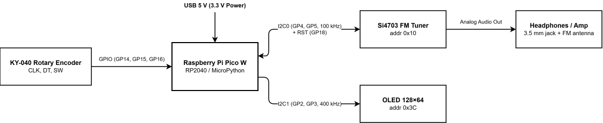
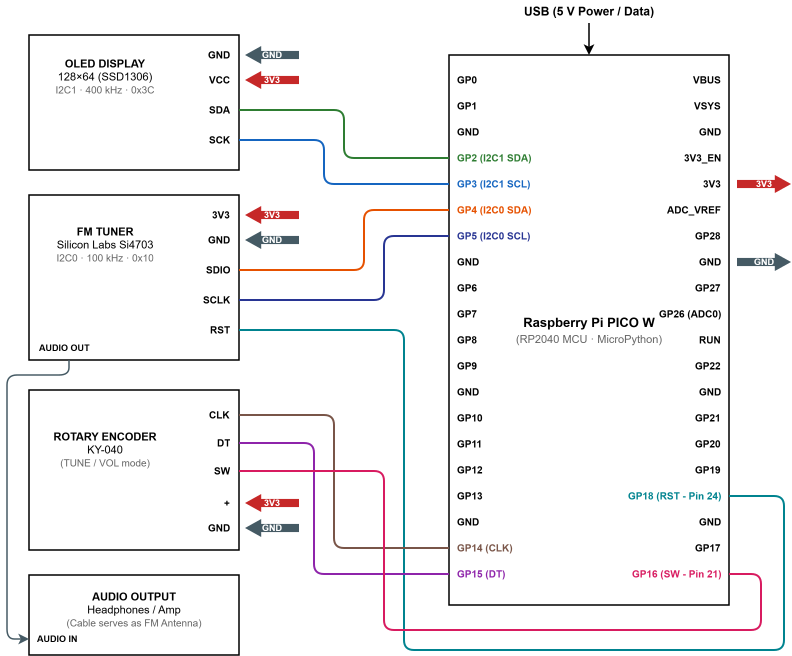

# DE2-FM-Radio (Raspberry Pi Pico W)

[](https://micropython.org/)
[](https://www.raspberrypi.com/products/raspberry-pi-pico/)
[](LICENSE)

FM Radio Receiver embedded systems term project for the **Digital Electronics 2 (DE2)** course at the **Faculty of Electrical Engineering and Communication (FEEC), Brno University of Technology (BUT)**.

---

## Team Members & Responsibilities

| Name | Role |
|---|---|
| **Lukáš Katrňák** | README, documentation, schematic *(doplnit zbytek rolí)* |
| **Aitken Alisher** | Source code, drivers *(doplnit zbytek rolí)* |
| **Murat Assiya** | Poster, Design *(doplnit zbytek rolí)* |

---

## 1. Project Overview

This project develops a compact FM receiver with digital tuning. A **Raspberry Pi Pico W** controls an **Si4703 FM tuner** through I2C. A rotary encoder provides frequency and volume control, while an OLED display presents frequency, volume, mode, and signal strength (RSSI).

### Problem Statement
> *[TODO: Popsat projekt v angličtině. Např.: Cílem projektu je vytvořit digitálně laditelný FM přijímač, který nahradí nepřesné analogové ladění a umožní přehledné zobrazení informací uživateli.]*

### Solution Summary
The **FM Radio Receiver** is based on the **Raspberry Pi Pico W** running MicroPython. It:
1. Tunes FM frequencies (87.5–108.0 MHz, 100 kHz European spacing) using an **Si4703** I2C tuner module.
2. Displays the current frequency, volume, mode (`TUNE` / `VOL`), and RSSI on a **128x64 OLED** display *(TODO: ověřit na reálné desce, zda je to 0.96" SSD1306 nebo 1.3" SH1106)*.
3. Allows frequency tuning and volume control using a **KY-040** rotary encoder with push-button.

---

## 2. Features and Scope

### Minimum Working Scope
- Tune the receiver using a KY-040 rotary encoder.
- Switch between `TUNE` and `VOL` modes using the encoder push-button.
- Display the selected frequency, volume, mode, and RSSI on an OLED screen.
- Route audio from the Si4703 3.5 mm headphone jack to headphones or a powered amplifier (the headphone cable also serves as the FM antenna).

### Planned Extensions
- Save and select station presets (`src/presets.py`).
- Automatically seek stations.
- Non-blocking multitasking using `uasyncio` and GPIO interrupts.
- Optional RDS decoding or secondary 4-digit display.

*These extensions are project goals, not claims of completed or tested functionality.*

---

## 3. Hardware, Wiring & Pinout

### Hardware Components

| Component | Description / Specifications | Interface / Protocol |
|---|---|---|
| **Raspberry Pi Pico W** | RP2040 microcontroller, 3.3 V logic | Core controller |
| **FM Module** | Silicon Labs Si4703 FM Tuner breakout (`0x10`) | I2C0 (100 kHz) + RST |
| **Display** | OLED 128x64 px (`0x3C` / `0x3D`) *(TODO: sjednotit SSD1306 vs. SH1106 s `oled_ui.py`)* | I2C1 (400 kHz) |
| **Rotary Encoder** | KY-040 with push-button | Digital GPIO (`PULL_UP`) |
| **Audio Output** | Headphones / powered speaker (3.5 mm jack) | Analog audio from Si4703 |

### Block & Wiring Diagram



### Wiring Schematic

> *[TODO: Exportovat opravené schéma z draw.io (s bílým pozadím) do `images/schema.svg` a zkontrolovat zobrazení níže.]*



### Pin Mapping (matches `src/config.py`)

All modules operate on **3.3 V logic** powered from Pico pin `3V3(OUT)` (Pin 36) and share a **common GND**. Never connect a speaker directly to a Pico GPIO pin.

| Module | Signal | Pico GPIO | Physical Pin | Bus / Mode |
|---|---|---|---|---|
| **Si4703** | SDIO (SDA) | `GP4` | Pin 6 | `I2C0` (100 kHz) |
| **Si4703** | SCLK (SCL) | `GP5` | Pin 7 | `I2C0` (100 kHz) |
| **Si4703** | RST | `GP18` | Pin 24 | Digital OUT *(TODO: opravit komentář pin 9 -> pin 24 v `config.py` a aktualizovat `docs/pin_mapping.md`)* |
| **OLED 128x64** | SDA | `GP2` | Pin 4 | `I2C1` (400 kHz) |
| **OLED 128x64** | SCL / SCK | `GP3` | Pin 5 | `I2C1` (400 kHz) |
| **KY-040** | CLK | `GP14` | Pin 19 | Digital IN (`PULL_UP`) |
| **KY-040** | DT | `GP15` | Pin 20 | Digital IN (`PULL_UP`) |
| **KY-040** | SW | `GP16` | Pin 21 | Digital IN (`PULL_UP`) |

---

## 4. Repository Layout

```text
DE2-FM-Radio/
├── README.md
├── LICENSE
├── .gitignore
├── docs/
│   └── pin_mapping.md        # TODO: doplnit Sphinx soubory (conf.py, index.rst)
├── images/
│   └── schema.svg            # TODO: nahrát opravené schéma a fotky zapojení
├── src/
│   ├── config.py             # GPIO pinout and radio constants
│   ├── main.py               # Main application loop
│   ├── si4703.py             # Si4703 I2C FM tuner driver class
│   ├── oled_ui.py            # OLED display UI wrapper class
│   ├── rotary_encoder.py     # KY-040 rotary encoder class
│   └── presets.py            # Station presets (placeholder)
└── tests/
    ├── test_i2c_scan.py
    ├── test_encoder.py
    ├── test_display.py
    └── test_radio.py
```

---

## 5. Software Architecture, Timing & Libraries

### Software Modules
- `src/config.py` — centralized GPIO configuration, I2C parameters, and FM band limits.
- `src/si4703.py` — `Si4703` driver class (2-wire I2C init sequence, tuning, volume, RSSI readout).
- `src/oled_ui.py` — `OLEDUI` class for rendering frequency, RSSI, volume, and active mode.
- `src/rotary_encoder.py` — `RotaryEncoder` class for reading rotation steps and debounced button presses.
- `src/presets.py` — saved station list *(in progress — placeholder list only)*.
- `src/main.py` — main application integrating tuner, encoder, and display.

### Task Timing & Concurrency
- **Current prototype (`src/main.py`):** Polls the encoder every **5 ms**, applies tuning/volume changes on input, and refreshes RSSI + OLED display every **1000 ms** (or immediately on change).
- **Planned non-blocking design (`uasyncio` + IRQ):** *(TODO: přepsat `rotary_encoder.py` a `main.py` podle této tabulky)*

| Task / Handler | Mechanism | Interval / Trigger | Responsibility |
|---|---|---|---|
| **Encoder IRQ** | `Pin.irq` (falling edge) | Asynchronous (event) | Only updates step counter `delta` or `btn_pressed` flag (200 ms debounce); no I2C calls in IRQ. |
| **`control_task`** | `uasyncio` coroutine | 20 ms | Reads encoder flags, toggles `TUNE`/`VOL` mode, updates `Si4703`, sets `ui_dirty`. |
| **`rssi_task`** | `uasyncio` coroutine | 1000 ms | Reads RSSI from Si4703 register `0x0A` and marks UI for refresh. |
| **`ui_task`** | `uasyncio` coroutine | 50 ms (on `ui_dirty`) | Redraws OLED only when state or RSSI changes. |

### MicroPython & Used Libraries

| Library / Module | Type | Purpose | Source / License |
|---|---|---|---|
| **MicroPython v1.22+** | Firmware | Runtime for Raspberry Pi Pico W (RP2040) | micropython.org (MIT) |
| `machine` (`Pin`, `I2C`) | Built-in | GPIO, hardware I2C0/I2C1, interrupts | MicroPython stdlib |
| `time` (`sleep_ms`, `ticks_ms`, `ticks_diff`) | Built-in | Reset timing and button debouncing | MicroPython stdlib |
| `uasyncio` | Built-in | Cooperative multitasking *(planned)* | MicroPython stdlib |
| `ssd1306.py` *(nebo `sh1106.py`)* | Third-party | Low-level I2C OLED display driver | *(TODO: doplnit přesný odkaz na zdroj a licenci + návod na nahrání na Pico)* |

---

## 6. Testing Plan

1. Verify 3.3 V power and common ground wiring.
2. Scan both I2C buses (`tests/test_i2c_scan.py`); confirm `0x10` (Si4703) on I2C0 and `0x3C`/`0x3D` (OLED) on I2C1.
3. Test the rotary encoder and button independently (`tests/test_encoder.py`).
4. Test OLED text output (`tests/test_display.py`).
5. Initialize the Si4703 and tune a known local FM station (`tests/test_radio.py`).
6. Check audio quality, RSSI updates, and user-interface responsiveness.

> *[TODO: Po otestování doplnit naměřené hodnoty (odezva, obnovovací frekvence displeje, rozsah RSSI) a fotky funkčního prototypu.]*

---

## 7. Project Progress & Checklist

- [x] **Hardware:** Breadboard assembly and basic wiring.
- [x] **Drivers:** Initial MicroPython classes (`Si4703`, `OLEDUI`, `RotaryEncoder`).
- [x] **Integration:** Basic working loop in `main.py` (tuning, volume, display).
- [ ] **Design:** Finalize schematic (`images/schema.svg`) and unify `docs/pin_mapping.md`.
- [ ] **Multitasking:** Refactor `main.py` and `rotary_encoder.py` to `uasyncio` + IRQ.
- [ ] **Extensions:** Presets / seek / RDS (optional).
- [ ] **Documentation:** Sphinx API docs setup (`docs/conf.py`, `docs/index.rst`).
- [ ] **Deliverables:** Final README, test results, A3 poster, and 1–2 min demo video.
